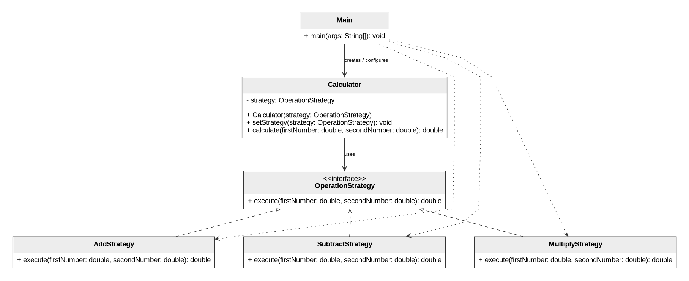

# Assignment 5 — Strategy Pattern

**Topic:** Calculator Using the Strategy Pattern  
**Group:** SE-2505  
**Student:** Yedigeyev Askar

## 1. Introduction

In this assignment, I implemented the **Strategy** behavioral design pattern in Java using a calculator. The calculator can perform three operations: addition, subtraction, and multiplication. These operations form a family of interchangeable algorithms.

Without the Strategy Pattern, a calculator might select operations using a long `if-else` chain or a `switch` statement. In my implementation, each operation has its own class implementing the same `OperationStrategy` interface. The `Calculator` class (Context) delegates the calculation to the selected strategy, while `Main` (Client) chooses and changes the strategy at runtime.

The goal is to keep the calculator independent of the details of individual mathematical operations and make the application easier to extend.

## 2. UML Class Diagram



**Class responsibilities:**

- **`OperationStrategy` (Strategy interface):** declares the common `execute(double, double)` method.
- **`AddStrategy`, `SubtractStrategy`, `MultiplyStrategy` (Concrete Strategies):** implement addition, subtraction, and multiplication separately.
- **`Calculator` (Context):** stores an `OperationStrategy` reference, calls its `execute()` method, and provides `setStrategy()` for runtime changes.
- **`Main` (Client):** creates the calculator, selects each strategy, and displays results.

The dashed lines with hollow triangle arrowheads mean that the concrete strategies implement the interface. The relationship from `Calculator` to `OperationStrategy` means that the context works through an abstraction instead of relying on a specific operation class.

### Runtime demonstration

The same `Calculator` object performs different calculations after the client changes the strategy:

```java
Calculator calculator = new Calculator(new AddStrategy());
System.out.println(calculator.calculate(10, 5)); // 15.0

calculator.setStrategy(new SubtractStrategy());
System.out.println(calculator.calculate(10, 5)); // 5.0

calculator.setStrategy(new MultiplyStrategy());
System.out.println(calculator.calculate(10, 5)); // 50.0
```

**Program output:**

```text
Strategy Pattern - Calculator
Addition: 15.0
Subtraction: 5.0
Multiplication: 50.0
```

## 3. Clean Code Principles

The **Before** snippets below are simplified examples of how the design could look *without* the principle. They are provided for comparison; they are not claimed to be earlier versions of my committed code. The **After** snippets describe the current implementation, except where an example is explicitly marked as a possible extension.

### 3.1. Replace conditional selection with polymorphism

**Before:** A calculator decides which operation to execute with conditional logic.

```java
if (operation.equals("add")) {
    return a + b;
} else if (operation.equals("subtract")) {
    return a - b;
} else {
    return a * b;
}
```

**After:** The context delegates to the strategy object selected by the client.

```java
public double calculate(double firstNumber, double secondNumber) {
    return strategy.execute(firstNumber, secondNumber);
}
```

**Why it is cleaner:** `Calculator` no longer contains a branch for every supported operation. Each concrete strategy provides its own implementation of `execute()`.

### 3.2. Use meaningful, intention-revealing names

**Before:** Generic names make it difficult to understand a class or method.

```java
class S1 {
    double run(double x, double y) { return x + y; }
}
```

**After:** Class and method names describe their purposes.

```java
public class AddStrategy implements OperationStrategy {
    @Override
    public double execute(double firstNumber, double secondNumber) {
        return firstNumber + secondNumber;
    }
}
```

**Why it is cleaner:** Names such as `AddStrategy`, `execute`, `firstNumber`, and `secondNumber` make the code easier to read during maintenance and review.

### 3.3. Follow the Single Responsibility Principle (SRP)

**Before:** One calculator class contains the code for several mathematical algorithms.

```java
class OldCalculator {
    double add(double a, double b) { return a + b; }
    double subtract(double a, double b) { return a - b; }
    double multiply(double a, double b) { return a * b; }
}
```

**After:** Each algorithm has its own dedicated class.

```java
public class SubtractStrategy implements OperationStrategy {
    @Override
    public double execute(double firstNumber, double secondNumber) {
        return firstNumber - secondNumber;
    }
}
```

**Why it is cleaner:** `SubtractStrategy` changes only when subtraction behavior needs to change. `Calculator` is responsible for delegating a calculation, not implementing the algorithms.

### 3.4. Depend on an abstraction, not concrete strategy classes

**Before:** The context is tied to a particular operation.

```java
class OldCalculator {
    private AddStrategy strategy = new AddStrategy();
}
```

**After:** The context stores and accepts the common interface.

```java
private OperationStrategy strategy;

public void setStrategy(OperationStrategy strategy) {
    this.strategy = strategy;
}
```

**Why it is cleaner:** `Calculator` can work with any class implementing `OperationStrategy`. It does not need to know the internal algorithm or the concrete strategy type.

### 3.5. Make extension possible without modifying existing classes (Open/Closed Principle)

**Before:** A condition-based calculator would require another branch whenever a new operation was introduced.

```java
// Adding a new operation would require editing existing selection logic:
// else if (operation.equals("power")) { return Math.pow(a, b); }
```

**After (example of a future extension):** A new algorithm could be added as a separate strategy without editing `Calculator`, `OperationStrategy`, or the existing three strategies.

```java
public class PowerStrategy implements OperationStrategy {
    @Override
    public double execute(double firstNumber, double secondNumber) {
        return Math.pow(firstNumber, secondNumber);
    }
}
```

The client could then select it with:

```java
calculator.setStrategy(new PowerStrategy());
```

**Why it is cleaner:** New behaviors are added through new classes, while the existing Context and Strategy contract remain unchanged. `PowerStrategy` is an extension example and is not part of the current three-operation program.

## 4. Conclusion

This assignment showed me how the Strategy Pattern separates different algorithms from the class that uses them. My calculator can switch between addition, subtraction, and multiplication at runtime by calling `setStrategy()`. No `if-else` or `switch` is needed in the `Calculator` context to identify the selected algorithm.

The main benefit is flexibility: I can introduce another operation by implementing `OperationStrategy` without rewriting the existing context. The trade-off is that the program has more classes than a basic calculator. For a very small program this can feel like extra structure, but the separation becomes useful as the number of algorithms grows.

## 5. GitHub Repository

**Repository link:** [Paste your GitHub repository URL here after publishing]

**Project files:** `OperationStrategy.java`, `AddStrategy.java`, `SubtractStrategy.java`, `MultiplyStrategy.java`, `Calculator.java`, `Main.java`, `README.md`, and this report.
